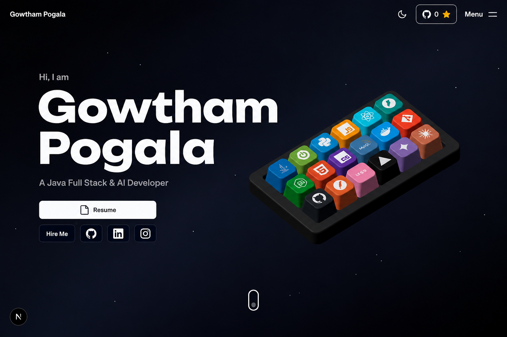

# 🚀 Gowtham Pogala | 3D Developer Portfolio

<div align="center">

### Java Full Stack & AI Developer

**An immersive, interactive developer portfolio built to showcase software engineering, artificial intelligence, and modern web development.**

A modern portfolio experience combining interactive 3D elements, fluid animations, responsive design, and a curated collection of real-world software projects.

[](https://nextjs.org/)
[](https://react.dev/)
[](https://www.typescriptlang.org/)
[](https://threejs.org/)
[](LICENSE)

</div>

---
## 🌐 Portfolio Preview

<div align="center">


**Interactive 3D Portfolio | Java Full Stack & AI Developer**

</div>

## 📖 Overview

This portfolio is designed to go beyond a traditional resume website.

It combines immersive 3D interactions, modern frontend technologies, and an organized project showcase to demonstrate my technical expertise and practical development experience.

The website highlights my work across:

- **Java Full Stack Development** — Building scalable applications and backend systems.
- **Artificial Intelligence** — Developing AI-powered applications using LLMs, RAG, and intelligent automation.
- **Frontend Engineering** — Creating responsive, accessible, and interactive web interfaces.
- **Workflow Automation** — Integrating APIs, services, and automated workflows.
- **Software Engineering** — Applying structured problem-solving and maintainable development practices.

## ✨ Key Features

| Feature | Description |
|---|---|
| Interactive 3D Keyboard | Skill-based 3D keyboard with animated interactions and technology icons |
| Immersive Interface | Dark cosmic theme with subtle particle effects and modern visual elements |
| Smooth Animations | GSAP and Framer Motion animations for interactive transitions |
| Project Showcase | Responsive project cards featuring screenshots, descriptions, and project links |
| Resume Integration | Built-in PDF resume viewer and download functionality |
| Contact Form | Contact form powered by Resend with input validation |
| Responsive Design | Optimized layouts for desktop, tablet, and mobile devices |
| Theme Switching | Light and dark mode support |
| Performance-Focused | Next.js rendering and optimized frontend architecture |
| Optional Realtime Features | Support for live cursors, online presence, and chat through a separate WebSocket backend |

---

## 🛠️ Technology Stack

| Category | Technologies |
|---|---|
| Framework | Next.js 16, React 19 |
| Programming | TypeScript, JavaScript |
| Styling | Tailwind CSS, Shadcn UI, Aceternity UI |
| 3D Graphics | Three.js, React Three Fiber, Chibi3D |
| Animation | GSAP, Framer Motion |
| Form Validation | Zod |
| Email Integration | Resend |
| Smooth Scrolling | Lenis |
| Theme Management | next-themes |
| Deployment | Vercel |

---

## 💼 Featured Projects

### 01. CiteQuire — Multi-PDF RAG Assistant

**Category:** AI / Retrieval-Augmented Generation

An AI-powered document intelligence application designed to help users interact with multiple PDF documents using natural language.

**Highlights:**
- Multi-document PDF processing
- Retrieval-augmented question answering
- Context-aware AI responses
- Document understanding and comparison
- Interactive document management interface

### 02. Vaani — Voice-First AI Assistant

**Category:** AI Automation

A multilingual voice-first AI assistant supporting Tamil and English commands.

**Tech Stack:** n8n, Telegram Bot API, Whisper, Gemini API, Google Calendar, Google Sheets, Docker

**Highlights:**
- Voice-to-text processing
- AI-powered intent classification
- Reminder and scheduling automation
- Expense logging
- Integration with productivity services

### 03. Kairo — Daily Routine & Productivity Tracker

**Category:** Productivity Application

A productivity-focused web application designed to help users manage daily routines, organize tasks, and monitor personal progress.

**Highlights:**
- Daily routine organization
- Productivity tracking
- Task management
- Modern dashboard interface

### 04. Resume Screener

**Category:** AI / Resume Analysis

**Status:** In Progress

An AI-powered resume screening and job-matching platform designed to analyze resumes against job descriptions.

**Tech Stack:** Python, LangChain, FAISS, FastAPI, React.js

**Highlights:**
- Resume parsing and analysis
- Semantic similarity matching
- Resume-to-job-description relevance scoring
- Candidate ranking
- ATS-focused resume evaluation

### 05. Kairo Dev Tracker — Java Full Stack Roadmap

**Category:** Developer Productivity / Education

A structured learning roadmap application designed to support Java Full Stack development preparation.

**Highlights:**
- Java and Spring Boot learning roadmap
- Topic-wise progress tracking
- Structured development milestones
- Interactive learning dashboard

### 06. Personal 3D Portfolio

**Category:** Web Development

An interactive developer portfolio featuring immersive 3D elements, responsive layouts, animated project cards, and a modern interface.

**Tech Stack:** Next.js, React, TypeScript, Tailwind CSS, Three.js, GSAP, Framer Motion

**Highlights:**
- Interactive 3D skill visualization
- Modern responsive project showcase
- Animated user interface
- Integrated resume viewer
- Contact form with Resend
- Optimized developer experience

---

## 📁 Project Structure

```text
3d-portfolio/
│
├── public/
│   └── assets/
│       ├── backgrounds/
│       ├── Portfolio/
│       ├── Resume/
│       │   └── Contact_Gowtham.pdf
│       └── projects-screenshots/
│
├── src/
│   ├── app/
│   │   ├── api/
│   │   │   └── send/
│   │   └── ...
│   │
│   ├── components/
│   │   ├── keyboard/
│   │   └── ...
│   │
│   └── data/
│       ├── config.ts
│       ├── projects.tsx
│       └── constants.ts
│
├── .env.example
├── package.json
└── README.md
```

---

## ⚙️ Getting Started

### Prerequisites

Make sure the following tools are installed:

- Node.js 20.9 or later
- pnpm 11
- Git
- VS Code or another preferred code editor

### 1. Clone the Repository

```bash
git clone https://github.com/gowtham16122004/folio-ai.git
cd folio-ai
```

### 2. Install Dependencies

```bash
pnpm install
```

### 3. Configure Environment Variables

Create a `.env.local` file in the project root.

```env
RESEND_API_KEY=your_resend_api_key

# Optional
NEXT_PUBLIC_WS_URL=
UMAMI_DOMAIN=
UMAMI_SITE_ID=
```

**Security:** Never commit `.env.local` or expose API keys in public repositories.

### 4. Start the Development Server

```bash
pnpm dev -- -p 3005
```

Open your browser and navigate to:

`http://localhost:3005`

### 5. Run Code Quality Checks

```bash
pnpm lint
pnpm typecheck
```

---

## 🎨 Customization

### Personal Information

Update:

`src/data/config.ts`

This file controls:

- Developer name and professional title
- Portfolio metadata
- Contact email
- Social media links
- GitHub profile configuration
- Website URL

### Projects

Update:

`src/data/projects.tsx`

Manage project titles, descriptions, screenshots, technologies, and external links.

### Skills and 3D Keyboard

Update:

`src/data/constants.ts`

Customize:

- Technology names
- Skill descriptions
- Keycap colors
- Technology icons
- Keyboard shortcuts

### Images and Assets

Store static assets under:

`public/assets/`

Reference them using public-relative URLs.

For example:

```tsx

```

For a PDF viewer, use an iframe or a dedicated document viewer rather than an image element.

---

## 📬 Contact Form

The portfolio includes a contact form powered by Resend.

**Contact email:** contactgowthamph@gmail.com

The API endpoint is located at:

`src/app/api/send/route.ts`

The contact form includes:

- Server-side input validation
- Email delivery integration
- Basic rate limiting
- Error handling
- Reply-to support

**Production note:** Resend requires a verified sending domain for sending emails beyond its testing recipient restrictions. The in-memory rate limiter should also be replaced with a shared rate-limiting service for production deployments.

---

## 🚀 Deployment

This portfolio is designed for deployment on Vercel.

1. Push the project to GitHub.
2. Import the repository into Vercel.
3. Configure the required environment variables.
4. Deploy the application.
5. Verify the contact form, resume viewer, and project links.

For production deployment, ensure that all API credentials and domain configurations are valid.

---

## 👨‍💻 About Me

I'm **Gowtham Pogala**, a Java Full Stack & AI Developer passionate about building intelligent applications, scalable backend systems, and engaging web experiences.

My technical interests include artificial intelligence, retrieval-augmented generation, Java backend development, automation, and modern frontend engineering.

I enjoy transforming technical ideas into functional applications that solve practical problems.

---

## 🌐 Connect With Me

**GitHub:** [github.com/gowtham16122004](https://github.com/gowtham16122004)

**Email:** contactgowthamph@gmail.com

Explore my repositories to learn more about my projects and technical work.

---

## 📄 License and Attribution

This portfolio is adapted from the open-source [3D Portfolio by Naresh Khatri](https://github.com/Naresh-Khatri/3d-portfolio), licensed under the MIT License.

The project has been personalized with my own profile information, project portfolio, screenshots, assets, and configuration.

The original MIT license and copyright notices are retained in accordance with the license terms.

---

<div align="center">

### Built with Next.js, TypeScript, and Three.js

**Gowtham Pogala — Java Full Stack & AI Developer**

*Building intelligent applications and interactive digital experiences.*

</div>